# 사주 기반 부적 추천 WEB 고도화 PRD

2026.11.13 · 윤민지 · 원본: https://claude.ai/artifact/VqvsLMEMMHpHAJ9J2F2Py6

## 1. 개요

이번 고도화는 지금의 "사주 입력 → 부적 추천" 단일 흐름을 **회원 · 결제 · 실물 배송이 붙은 판매 서비스**로 바꾸는 작업입니다. 픽셀아트 디자인과 만세력·부적 추천 로직은 그대로 가져가고, 로그인·상품 3종·주문 상태·마이·리뷰를 새로 만듭니다.

**목표**

- 메인에서 어떤 서비스인지 10초 안에 이해하고 CTA로 사주 등록까지 이어지게 한다.
- 무료 구간(일간 5줄 해석 + 만세력)으로 신뢰를 만든 뒤 유료 3종으로 전환시킨다.
- 결제·환불·배송·교환·반품을 지민 혼자 운영할 수 있을 만큼 단순한 상태 로직으로 굴린다.

**범위**

| 포함 | 제외(이번 버전) |
| --- | --- |
| 카카오·구글 소셜 로그인 | 이메일/비밀번호 가입, 애플 로그인 |
| 사주 등록(1계정 최대 8명), 탭 전환 | 궁합, 대운·세운 등 추가 풀이 상품 |
| 상품 3종 결제, 환불 | 정기결제, 쿠폰·포인트 |
| 디지털 부적 선택·이미지 다운로드 | 부적 재선택, 고민 재선택 |
| 실물 부적 배송·교환·반품 상태 관리 | 해외 배송 |
| 리뷰 작성 → 메인 노출 | 리뷰 포토, 리뷰 보상 |
| 관리자: 주문·입금·배송·리뷰 관리 | 정산·세무 자동화 |

**성공 지표(초안, 출시 후 4주 기준으로 수치 확정)**

- 메인 → 사주 등록 완료율
- 사주 등록 → 결제 전환율, 상품별 비중(결제1 : 2 : 3)
- 결제 → 부적 선택 완료율(이탈 지점 확인용)
- 환불·반품 요청률, 배송 평균 소요일
- 리뷰 작성률

## 2. 현황 (SAJU\_v0.2 기준)

지금 코드는 **10/21 부스 이벤트용 공용 기기 버전**이라 회원·결제·배송 개념이 전혀 없습니다. 계산과 디자인은 재사용하고, 저장 구조는 바꿔야 합니다.

| 영역 | 지금 있는 것 | 고도화에서 할 일 |
| --- | --- | --- |
| 스택 | Vite + React 19 + TypeScript + Tailwind v4, Netlify Functions, Netlify Blobs | 프런트 유지. 저장소는 회원·주문 조회가 가능한 DB로 교체(§10) |
| 화면 | 입력(2스텝) → 결과(만세력·신살·오행·부적 3종 선택), 재진입 화면(꺼 둠) | 메인·로그인·내 사주·마이 신설, 결과 화면을 '내 사주'로 재구성 |
| 사주 계산 | `ssaju` + 자체 파이프라인(음력·서머타임·진태양시·시간 미상·신살 26종) | 그대로 사용 |
| 부적 추천 | 상위 카테고리 8개, 부족 오행 점수제, 사전 테이블 120종 | 프로젝트 문서 v2(상위 9 × 하위 40, 사자성어 217개, 1,000칸)로 교체 |
| 풀이 | 사용자 화면엔 없음. 어드민에서만 AI 간단 풀이 1회 생성 | 일간 5줄 해석(무료), 고민별 5페이지(유료) 신설 |
| 어드민 | 로그인, 참여자 목록·상세, 부적 변경, 메모, 방문·이탈 통계 (shadcn/ui, 라이트 테마) | 주문·입금·배송·환불·리뷰 관리 추가 |
| 개인정보 | 접수 15일 후 익명화(스케줄 함수) | 회원 보관 정책으로 새 동의서 필요. 이벤트 데이터는 이관하지 않음 |
| 디자인 | 다크 배경 + 픽셀 폰트(Mona) + 마젠타 포인트, 일간 캐릭터 10종 | 유지. 토큰·컴포넌트는 §9 |

기존 PRD v2.2의 고도화 리스트(로그인 → 장기 저장 → 부적 저장 → 사용자 풀이 → 결제)가 이번 범위와 거의 겹칩니다. 순서만 "결제가 붙는 판매 흐름" 중심으로 다시 잡았습니다.

**확인하지 못한 것**: 요청하신 `사주 분석.txt`는 SAJU\_v0.2 폴더에는 없었고, 11/13 프로젝트 문서(사주 분석 가이드, 프롬프트 원문)로 올라온 것을 §8.6에 반영했습니다.

## 3. 경쟁사 리서치

읽을 수 있었던 자료 안에서는 **"무료로 들어와서 유료로 넓히는" 구조가 공통**이고, 사주 풀이와 실물 부적 배송을 한 흐름으로 묶은 곳은 확인되지 않았습니다. 다만 근거가 얇습니다. 포스텔러·점신 공식 사이트는 본문이 읽히지 않았고, 가격이 적힌 곳은 한 곳뿐이었습니다.

| 서비스 | 무료 구간 | 유료 구간 | 결제 방식 | 참고할 점 |
| --- | --- | --- | --- | --- |
| [포스텔러](https://brunch.co.kr/@4e2b4f97d7214af/39) | 오늘의 운세, 타로, 월간 리포트 | 단계별 리포트 패키지(가격 미확인) | 앱 내 포인트 충전 후 열람 | 카드·그래프 UI가 초심자에게 쉽고 결제 유도가 과하지 않다는 평가 |
| [점신](https://brunch.co.kr/@4e2b4f97d7214af/39) | 종합 운세, 정통사주·만세력, 타로, 궁합 | 전문가 실시간 상담(가격 미확인) | 미확인 | 후기·별점·상담 가능 시간을 신뢰 장치로 사용 |
| [마이파이](https://brunch.co.kr/@4e2b4f97d7214af/39) | 기질 분석, 직업 적합도 | 전화 상담 약 1시간 | 미확인 | "해석 → 실행"으로 이어지는 구조, 정돈된 디자인 |
| [인생×사주](https://sajuai.io/ko/explore/saju-apps) | 명식, 오행·용신, 매일 운세 등 대부분 | AI 심층 분석 1편 1,900원부터, 광고 제거 월 5,900원 | 단건 + 월 구독 | 자동 해석형 중 가격이 공개된 유일한 사례 |
| [헬로우봇](https://sajuai.io/ko/explore/saju-apps) | 캐릭터 챗봇형 사주·타로 일부 | 일부 유료(가격 미확인) | 미확인 | 캐릭터와 게임 요소로 재미를 줌 |

**시사점**

- 무료 구간이 충분해야 결제로 넘어갑니다. "일간 5줄 + 만세력"을 무료로 두는 지금 설계는 이 패턴과 맞습니다.
- 부쳐드림의 차별점은 **직접 그린 실물 부적**과 **일간 캐릭터**입니다. 메인 첫 화면에서 이 두 가지가 보여야 합니다.
- 점신처럼 후기가 신뢰 장치가 됩니다. 리뷰를 메인에 노출하는 요구사항은 유지하되, 초기엔 리뷰가 0건이므로 빈 상태 디자인이 필요합니다.
- 가격 기준점이 거의 없습니다. 출시 전 포스텔러·점신 앱을 직접 설치해 리포트 가격을 확인하는 것을 권합니다(§13 체크리스트).
- 시장 규모·주 이용 연령대는 이번에 확인한 자료에 수치가 없었습니다.

## 4. 상품 구성

상품은 **디지털 1종 + 실물 포함 2종**이고, 세 상품의 디지털 구성은 동일합니다. 차이는 직접 그린 큰부적의 장수뿐입니다.

| 구성 | 결제 전(무료) | 결제1 | 결제2 | 결제3 |
| --- | --- | --- | --- | --- |
| 일간 5줄 해석 + 만세력 | O | O | O | O |
| 고민별 사주 분석 5페이지 | — | O | O | O |
| 부적 추천 3종(퍼스널 추천 포함) | — | O | O | O |
| 부적 1종 선택 → 이미지 다운로드(재선택 불가) | — | O | O | O |
| 직접 그린 큰부적 배송 | — | — | 1장 | 3장 |
| 배송지 입력·배송 상태 | — | — | O | O |

**구매 단위**: 주문 1건 = 사주 1명 × 고민 1개 × 상품 1종. 8명을 등록했다면 사람마다 따로 결제하고, 같은 사주로 다른 고민을 추가 결제할 수 있습니다(§6.7).

**정해야 할 것** (권장안을 기본값으로 적었습니다)

| # | 질문 | 권장안 | 이유 |
| --- | --- | --- | --- |
| 1 | 결제3의 큰부적 3장은 무엇인가 | 추천된 3종을 각 1장씩 | "선택한 1종을 3장"보다 가치가 분명하고, 3종 추천과 자연스럽게 이어집니다 |
| 2 | 결제2의 큰부적 1장은 무엇인가 | 디지털로 선택한 그 1종 | 선택이 겹치면 제작 목록이 단순해집니다 |
| 3 | "퍼스널 추천"의 정의 | 3종 중 대표 부적(각 칸 1번)에 '퍼스널 추천' 배지 | 프로젝트 문서의 "1번 고정 + 나머지 2개" 규칙과 맞습니다 |
| 4 | 같은 사주로 다른 고민을 또 살 수 있나 | 가능. 고민마다 주문 1건, 이미 산 고민은 '구매함'으로 표시 | 확정(11/13 지민). 흐름은 §6.7 |
| 5 | 결제1 → 결제2·3 업그레이드 | 1차 출시 제외 | 차액 결제·부분 환불 로직이 추가로 필요합니다 |
| 6 | 가격 | 미정 | 결제2·3은 건당 배송비(§12)·포장·재료·결제 수수료(§11)와 그리는 시간을 더한 값이 하한선입니다 |
| 7 | 주간 제작 가능 수량 | 상한을 두고 초과 시 '제작 대기 N일' 안내 | 손으로 그리는 상품이라 주문이 몰리면 배송 약속을 지킬 수 없습니다 |

**잠금 규칙**

- 고민은 **결제 완료 시점**에 잠깁니다. 결제 전에는 바꿀 수 있어야 합니다. 요청서의 "선택 완료 시 재선택 불가"를 이렇게 해석했습니다.
- 부적은 **\[선택 완료\] 확인 팝업에서 확인을 누른 시점**에 잠깁니다. 팝업 문구는 "선택 후에는 변경할 수 없어요".
- 결제된 사주는 생년월일·시간·성별 수정과 삭제를 막습니다. 닉네임만 수정 가능합니다.

## 5. IA 및 사용자 플로우

메인 CTA와 GNB '내 사주'는 **같은 분기**를 탑니다: 로그인이 안 돼 있으면 로그인, 사주가 없으면 등록, 둘 다 있으면 내 사주.

```mermaid
flowchart LR
  A["메인 CTA / GNB 내 사주"] --> B{"로그인 됨?"}
  B -- 아니오 --> L["로그인 (카카오 · 구글)"] --> C
  B -- 예 --> C{"사주 있음?"}
  C -- 아니오 --> R["사주 정보 등록 (계정당 최대 8명)"] --> M
  C -- 예 --> M["내 사주 (무료): 5줄 해석 + 만세력"]
  M -- "하단의 작은 부적 보기 버튼" --> W["고민 선택 (상위 9 · 하위 40)"]
  W --> P["상품 선택·결제 (결제 후 고민 잠금)"]
  P --> G["분석 5페이지 (1회 생성 후 저장)"]
  G --> T["부적 1종 선택 (추천 3종 중 · 잠금)"]
  T --> S["이미지 저장 (재선택 불가)"]
  S -- "결제2·3만" --> D["배송지 입력 → 배송 상태"]
```

로그인과 사주 등록을 마치면 원래 흐름으로 합류합니다. 유료 단계는 내 사주 하단의 작은 버튼에서 시작하고, 배송지 입력은 결제2·3에만 붙습니다.

### 메뉴 구조

- **홈** `/` : 소개, 상품 3종, 리뷰, CTA
- **내 사주** `/saju` : 사주 탭(최대 8) + 상태별 화면
  - 사주 등록 `/saju/new`
  - 고민 선택 → 상품 선택 → 주문 확인·결제 `/saju/:id/order`
  - 고민별 분석 5페이지 `/saju/:id/reading`
  - 부적 추천·선택 `/saju/:id/talisman`
  - 배송지 입력 `/saju/:id/shipping`
- **마이** `/my` : 내 정보, 결제 정보, 배송 정보, 리뷰 작성, 문의하기, 로그아웃
- **로그인** `/login` (GNB에는 없음)
- 약관·개인정보처리방침·환불 정책 (푸터)
- 어드민 (별도 경로, 일반 사용자에게 노출 안 함)

### 분기 규칙

| 상황 | 동작 |
| --- | --- |
| 비로그인 + 내 사주/마이/CTA | 로그인으로 이동, 완료 후 원래 목적지로 복귀 |
| 로그인 + 사주 0건 | "사주 정보를 등록해 주세요 :-)" + \[사주 정보 등록하기\] |
| 로그인 + 사주 1건 이상 | 마지막으로 본 사주 탭을 열어 상태별 화면 표시(§6.5) |
| 결제 중 이탈(창 닫음·실패) | 주문을 만들지 않거나 취소 처리, 고민은 잠기지 않음 |
| 세션 만료 | 로그인으로 이동, 완료 후 보던 화면으로 복귀 |

## 6. 화면별 요구사항

모든 사용자 화면은 모바일 우선(375px 설계, 320px 최소)이고 상단에 로고와 GNB(홈 · 내 사주 · 마이)가 고정됩니다.

### 6.1 공통: 상단 헤더·GNB

- 좌측 로고(홈으로 이동), 우측 메뉴 3개. 현재 메뉴는 마젠타 밑줄로 표시합니다.
- 비로그인 상태에서 '내 사주'·'마이'를 누르면 로그인 화면으로 보내고, 로그인 후 원래 가려던 곳으로 돌아옵니다.
- 하단 푸터: 사업자 정보, 이용약관, 개인정보처리방침, 환불·배송 정책 링크(§13).

### 6.2 메인(홈)

| 순서 | 섹션 | 내용 |
| --- | --- | --- |
| 1 | 히어로 | 한 줄 소개 + 일간 캐릭터 + 주 CTA **\[내 사주 보러 가기\]** |
| 2 | 이용 방법 | 사주 등록 → 무료 해석 → 고민 선택·결제 → 부적 받기, 4단계 |
| 3 | 무료로 받는 것 | 일간 5줄 해석과 만세력 예시 화면 |
| 4 | 상품 3종 | 구성 비교 카드(§4 표), 가격, 실물 부적 사진 |
| 5 | 직접 그리는 부적 | 제작 과정 사진·짧은 소개(신뢰 요소) |
| 6 | 리뷰 | 공개 리뷰 최신순. 0건이면 섹션을 숨깁니다 |
| 7 | 자주 묻는 질문 | 배송 기간, 환불, 태어난 시간을 모를 때 |
| 8 | 하단 CTA | 히어로와 같은 버튼 |

- CTA 동작은 GNB '내 사주'와 동일한 분기(§5)를 탑니다.
- 효험을 보장하는 표현("반드시 이루어집니다" 등)은 쓰지 않고, 기존 톤인 "응원·바람"으로 씁니다.

**상태별 메인** (11/13 추가)

| 방문자 상태 | 히어로 문구·CTA | 고민 진열 영역 |
| --- | --- | --- |
| 비로그인 또는 사주 없음 | 사주 등록 유도 **\[내 사주 등록하기\]** + 부적 소개 | 상위 고민 9개 카드. 누르면 로그인·등록 후 그 고민이 선택된 채로 이어짐 |
| 사주 있음, 결제 없음 | "{닉네임}님의 고민에 맞는 부적" **\[부적 받으러 가기\]** | 상위 고민 9개 카드 → 하위 고민 선택으로 바로 진입 |
| 사주 있음, 결제 있음 | **\[다른 고민 보러 가기\]** | 같은 카드. 이미 산 고민이 있는 상위 카드에 '구매함 N' 표시 |

- 메인을 고민별로 나누는 것은 **진열(무엇을 살 수 있는지 보여주기)** 용도로만 쓰고, 실제 고민 선택·결제 화면은 내 사주 쪽 하나만 둡니다. 구매 화면이 두 벌이면 '구매함' 표시·재선택 알럿·잠금 규칙을 두 번 만들고 두 번 맞춰야 합니다.
- 메인에는 상위 9개만 올립니다. 하위 40개를 다 펼치면 첫 화면이 목록이 되어 소개 역할을 못 합니다.
- 사주가 여러 명이면 메인 카드를 눌렀을 때 "누구의 고민인가요?"를 먼저 묻습니다.

### 6.3 로그인

- 카카오, 구글 두 버튼만 제공합니다. 버튼은 각 사의 브랜드 가이드 색·로고를 따릅니다(픽셀 스타일 예외).
- 최초 로그인 시 약관·개인정보 수집 동의(필수), 마케팅 수신(선택)을 받습니다.
- 같은 이메일로 카카오와 구글에 각각 가입한 경우는 별개 계정으로 둡니다(1차 출시 기준).

### 6.4 사주 정보 등록

- 기존 입력 화면을 재사용합니다: 닉네임, 성별, 양력/음력/윤달, 생년월일, 시간(모름 가능).
- **고민 카테고리는 등록 단계에서 빼고** 결제 직전 단계로 옮깁니다.
- 계정당 최대 8명. 8명이면 추가 버튼을 비활성화하고 "최대 8명까지 등록할 수 있어요"를 보여줍니다.
- 가족·지인 사주를 등록할 때 "본인 동의를 받았어요" 체크를 받습니다.

### 6.5 내 사주

상단에 사주 탭(닉네임, 최대 8개)과 \[+ 사주 추가\]가 있고, 탭을 누르면 아래 내용이 그 사람 것으로 바뀝니다. 탭이 화면을 넘으면 가로 스크롤합니다.

| 상태 | 보이는 것 | 주 버튼 |
| --- | --- | --- |
| 등록된 사주 없음 | "사주 정보를 등록해 주세요 :-)" | \[사주 정보 등록하기\] |
| 등록 O, 결제 전 | 일간 캐릭터 + 5줄 해석, 만세력(십신·신살·오행 분포) | 하단에 작게 \[내 고민에 맞는 부적 보기\] |
| 입금 대기 | 위 내용 + 입금 계좌·금액·기한 안내 카드 | \[계좌번호 복사\] |
| 결제 완료, 부적 선택 전 | 위 내용 + \[고민별 사주 보기\] | 분석 5페이지 → 부적 3종 → 선택 |
| 부적 선택 완료 | 선택한 부적 카드 + \[이미지 저장\], 분석 다시 보기 | \[이미지 저장\] |
| 결제2·3, 배송지 미입력 | 위 내용 + 배송 부적 안내 | \[배송지 입력하기\] |
| 결제2·3, 배송지 입력 후 | 배송 상태 배지, 송장번호(있으면) | \[배송 조회\] |

**고민 선택 → 상품 선택 → 결제**

1. 상위 고민 9개 중 1개, 이어서 하위 고민 1개를 고릅니다(총 40개, §8).
2. 상품 3종 중 1개를 고릅니다. 결제2·3은 예상 제작·배송 기간을 함께 보여줍니다.
3. 주문 확인 화면에서 고민·상품·금액을 확인하고, "결제 후에는 고민을 바꿀 수 없어요"와 환불 규정에 동의한 뒤 결제합니다.

**고민별 사주 분석 5페이지**

- 가로 스와이프 + 하단 페이지 표시(1/5). 마지막 페이지 버튼은 \[부적 추천 보기\].
- 생성이 끝나지 않았으면 기존 로딩 로티를 보여줍니다. 실패하면 "잠시 후 다시 시도"와 문의 안내를 보여주고 어드민에 표시합니다.

**부적 추천·선택**

- 카드 3장: 한글·한자, 뜻, 사주 연결 문장, 추천 의미. 대표 부적에 '퍼스널 추천' 배지.
- 1장 선택 → \[선택 완료\] → 확인 팝업 → 잠금. 이후 이미지 저장 버튼이 열립니다.
- 이미지는 휴대폰 배경화면 비율(9:16)과 정사각(1:1) 두 가지를 제공하는 것을 권합니다.

**배송지 입력(결제2·3)**

- 받는 사람, 연락처, 우편번호 검색, 주소, 상세주소, 배송 메모.
- 발송 전(배송 대기)까지만 수정할 수 있습니다.
- 결제 후 7일 동안 배송지가 비어 있으면 알림을 보냅니다(채널은 §14 미결정).

### 6.6 마이

| 메뉴 | 내용 |
| --- | --- |
| 내 정보 | 로그인 수단, 이메일, 마케팅 수신 설정, 하단에 \[회원 탈퇴\] |
| 결제 정보 | 주문별 상품·금액·결제 상태(§7). 입금 대기면 계좌번호 표시. \[환불 요청\]·\[반품 신청\] 진입 |
| 배송 정보 | 주문별 배송 상태(§7), 택배사·송장번호, \[배송 조회\], 배송지 수정(발송 전) |
| 리뷰 작성 | 결제 완료 주문당 1건. 별점(1\~5), 본문(10\~300자), 공개 닉네임 |
| 문의하기 *(11/13 추가)* | 유형(결제 / 배송 / 교환·반품 / 사주·분석 / 기타), 관련 주문 선택(선택), 본문, 사진 첨부(선택). 내 문의 내역과 상태(접수 / 답변 완료), 답변 보기 |
| 로그아웃 | 화면 맨 아래 작은 텍스트 링크 |

**문의하기 규칙**

- 유형에서 '교환·반품'이나 '환불'을 고르면 문의 작성 대신 해당 신청 화면으로 안내합니다. 같은 요청이 문의와 신청 두 곳으로 들어오면 상태가 어긋나고 처리를 두 번 하게 됩니다.
- 답변이 달리면 알림을 보냅니다(1차는 이메일). 알림이 없으면 사용자가 답을 확인하러 다시 들어와야 합니다.
- 답변 예상 시간(예: 영업일 기준 1\~2일)을 작성 화면에 적습니다.
- 비로그인 문의(결제 전 질문, 로그인 문제)는 마이 안에서는 받을 수 없으므로 푸터에 문의 이메일을 함께 둡니다.

* 탈퇴: 진행 중인 주문(입금 대기·배송 중·환불 검토중)이 있으면 막고 이유를 알려줍니다. 탈퇴 후 7일 안에 사주·풀이 등 개인정보를 삭제하고, 통계는 익명 집계로 남기며, 거래 기록은 법정 보관 기간 동안 분리 보관합니다(§10.3).
* 리뷰는 DB에 저장되고 **관리자 승인 후** 메인에 노출하는 것을 권합니다. 즉시 노출은 욕설·개인정보가 메인에 그대로 뜨는 위험이 있습니다.

### 6.7 다른 고민 추가 결제 (11/13 추가)

**진입은 두 곳, 구매 화면은 한 곳**을 권합니다. 메인의 고민 카드와 내 사주 하단의 \*\*\[다른 고민 선택하기\]\*\*가 같은 고민 선택 화면으로 들어옵니다. 질문하신 두 안 중 하나를 고르는 대신 둘을 이렇게 역할로 나눴습니다.

- 내 사주 화면 구성이 바뀝니다: 무료 영역(5줄 해석 + 만세력) 아래에 **구매한 고민 카드 목록**(고민명, 상태, 선택한 부적, 구매일)이 쌓이고, 맨 아래에 \[다른 고민 선택하기\]가 붙습니다. §6.5의 상태별 화면은 이 카드 하나하나에 적용됩니다.
- 고민 선택 화면에서 이미 산 하위 고민은 숨기지 않고 \*\*'구매함 · YYYY.MM.DD'\*\*로 표시합니다. 숨기면 "내가 뭘 샀더라"를 확인할 수 없고, 아래 재선택 알럿도 띄울 수 없습니다.
- 이미 산 고민을 다시 고르면 알럿: **"{YYYY.MM.DD}에 선택한 기록이 있습니다. 다시 선택하시겠습니까?"** \[취소\] / \[다시 선택\]. 입금 대기 중인 같은 고민이 있으면 재결제 대신 그 주문으로 보냅니다.

**정해야 할 것: 같은 고민을 다시 사면 무엇이 달라지는가.** 사주가 같으면 계산 결과도 같아서, 지금 설계대로면 대표 부적이 똑같이 나오고 분석 내용도 거의 같습니다. 돈을 다시 받았는데 같은 것을 주면 환불 사유가 됩니다. 권장안은 ① 재구매 시 이전에 받은 부적을 뺀 나머지에서 3종을 추천하고 ② 분석은 "지금 시점" 기준으로 새로 생성하며 ③ 알럿에 "새 분석과 새 부적 추천을 받아요"를 한 줄 덧붙이는 것입니다. 한 칸의 부적이 5개뿐이라 같은 고민 재구매는 사실상 1\~2회가 한계입니다.

### 6.8 부적 1년 갱신 (11/13 추가)

| 대상 | 시점 | 동작 |
| --- | --- | --- |
| 배송 부적 | 배송완료 후 1년 | 알림 발송: 1년이 지났으니 태우고 새로 받기를 권하는 안내 + 재주문 링크 |
| 이미지 부적 | 선택 후 1년이 지난 뒤 내 사주 진입 시 | 팝업 → \[취소\] / \[NNNN원 결제\] → 결제 완료 → 불타는 모션 → 새 부적 생성 모션 → 새 이미지(다운로드 가능) |

기능은 그대로 담되, 세 가지는 고쳐서 넣는 것을 권합니다.

1. **문구**: "부적은 1년까지만 효력"은 효력을 단정하는 표현이라, 돈을 받는 화면에 쓰면 분쟁 소지가 큽니다(미확실, 표시·광고 관련 확인 필요). 권장 문구: "받은 지 1년이 지난 부적이 있어요. 부적은 1년마다 태우고 새로 받는 것을 권해요. 새 부적으로 바꿀까요?"
2. **노출 방식**: 진입할 때마다 결제 팝업이 뜨면 강매로 읽힙니다. 최초 1회 팝업 후에는 해당 고민 카드의 배지('1년 지남')와 \[새 부적 받기\] 버튼으로 남기고, \[취소\]를 누른 사람의 기존 이미지는 계속 볼 수 있게 둡니다.
3. **알림톡**: 카카오 알림톡은 주문·배송 같은 정보성 안내용이고, 재구매를 권하는 내용은 광고성 메시지로 분류될 가능성이 높습니다(미확실, 발송 대행사에 확인 필요). 그 경우 광고성 수신 동의를 받은 사람에게만, 야간을 피해 보내야 합니다. 발송에는 카카오 비즈니스 채널과 발송 대행사 계약, 건당 비용이 듭니다.

**추가로 정할 것**

- 갱신 가격(NNNN원)과, 실물 부적 갱신 시 배송 포함 가격.
- 새 부적은 **같은 사자성어의 새 이미지**인지 **같은 고민의 다른 사자성어**인지. 모션 뒤 바로 새 이미지가 나오는 흐름이라 선택 단계 없이 자동 배정으로 적었고, 권장은 이전에 받지 않은 것 중 자동 배정입니다.
- 태운 이전 이미지를 계속 보관·다운로드하게 할지(권장: '지난 부적'으로 흐리게 보관).
- 이 기능은 **첫 판매 1년 뒤에야 처음 쓰입니다.** 지금 만들 것은 부적 발급일·배송완료일 저장과 광고성 수신 동의 받기뿐이고, 화면·모션·알림은 뒤로 미뤄도 됩니다.

## 7. 결제·배송 상태 로직

주문 1건은 **결제 상태 1개와 배송 상태 1개**를 따로 가집니다. 결제1은 배송 상태가 없습니다. 상태는 요청하신 목록을 그대로 쓰고, 운영에 필요한 2개(주문 취소, 제작 중)를 추가 제안합니다.

### 7.1 결제 상태

| 상태 | 사용자에게 보이는 것 | 들어오는 조건 | 다음 상태 |
| --- | --- | --- | --- |
| 입금 대기 | 계좌번호·금액·입금 기한, \[계좌번호 복사\] | 계좌 결제로 주문 생성 | 결제 완료 / 주문 취소 |
| 결제 완료 | "결제 완료", 결제일·금액 | 입금 확인(자동 또는 관리자), 카드·간편결제 승인 | 환불 신청 |
| 환불 신청 | "환불 신청 접수", 접수일 | 사용자가 환불 요청 또는 반품 신청 완료 | 환불 검토중 |
| 환불 검토중 | "환불 검토중" | 관리자가 요청을 확인(실물은 회수·사진 확인 대기) | 환불 완료 / 결제 완료(반려) |
| 환불 완료 | "환불 완료", 환불일·금액 | 관리자가 환불 처리 | 종료 |
| 주문 취소 *(추가 제안)* | "입금 기한이 지나 취소됐어요" | 입금 기한(예: 3일) 경과, 또는 입금 전 사용자 취소 | 종료. 다시 주문 가능 |

- 유료 콘텐츠(분석 5페이지·부적)는 **결제 완료**일 때만 열립니다. 환불 완료가 되면 다시 잠깁니다.
- 주문 취소가 없으면 입금하지 않은 주문이 영원히 '입금 대기'로 남아 재주문을 막습니다.

### 7.2 배송 상태 (결제2·3)

| 묶음 | 상태 | 사용자에게 보이는 것 | 들어오는 조건 | 다음 상태 |
| --- | --- | --- | --- | --- |
| 배송 | 배송 대기 | 배송지 미입력이면 \[배송지 입력하기\], 입력 후 "부적을 그리고 있어요" | 결제 완료 | 배송중 |
| 배송 | 배송중 | 택배사·송장번호, \[배송 조회\] | 관리자가 송장번호 입력 | 배송 완료 |
| 배송 | 배송 완료 | "배송 완료", \[교환 신청\]·\[반품 신청\](기한 내) | 관리자 처리 또는 조회 API | 교환 신청 / 반품 신청 |
| 교환 | 교환 신청 | "교환 신청 접수", 사유·사진 | 사용자가 교환 신청 완료 | 교환 배송중 / 배송 완료(반려) |
| 교환 | 교환 배송중 | 새 송장번호, \[배송 조회\] | 관리자가 승인 후 다시 그려 발송 | 교환 완료 |
| 교환 | 교환 완료 | "교환 완료" | 재발송분 도착 | 종료 |
| 반품 | 반품 신청 | 반품 보낼 주소·방법 안내 | 사용자가 반품 신청 완료 | 반품 배송중 / 배송 완료(반려) |
| 반품 | 반품 배송중 | "반품 물품이 돌아오고 있어요", 회수 송장번호 | 사용자가 발송 후 송장번호 입력, 또는 관리자 처리 | 반품 완료 |
| 반품 | 반품 완료 | "반품 완료" | 관리자가 회수 확인 | 종료 |

- '대기'를 내부적으로 **배송지 대기 / 제작 중 / 발송 준비** 세 단계로 나눠 어드민에서 관리하는 것을 권합니다. 사용자에게는 문구만 다르게 보여주면 됩니다.
- 배송완료 전환은 1차 출시에서 관리자 수동 처리, 또는 발송 후 N일 자동 전환으로 충분합니다(§12).

### 7.3 결제와 배송이 맞물리는 규칙

| 사건 | 결제 상태 | 배송 상태 |
| --- | --- | --- |
| 사용자가 반품 신청 완료 | 환불 신청 | 반품 신청 |
| 관리자가 반품 요청 확인, 물품 회수 중 | 환불 검토중 | 반품 배송중 |
| 관리자가 회수 확인 + 환불 처리 | 환불 완료 | 반품 완료 |
| 관리자가 반품·환불 반려 | 결제 완료 | 배송 완료 |
| 교환 신청 → 승인(파손·오배송) | 변화 없음 | 교환 신청 → 교환 배송중 → 교환 완료 |
| 결제1 환불 요청 | 환불 신청 → 환불 검토중 | — |

### 7.4 환불·교환·반품 정책 초안 (법률 자문 아님, 확정 전 확인 필요)

- **디지털 풀이**: 분석 페이지를 열기 전에는 전액 환불, 열람 후에는 환불 불가로 두는 안이 일반적입니다. 이렇게 하려면 결제 전에 이 사실을 알리고 동의를 받아야 합니다(미확실: 전자상거래법상 청약철회 제한 요건).
- **직접 그린 부적**: 주문 후 개별 제작하는 상품이라 제작 시작 후 단순 변심 반품을 제한할 여지가 있지만, 역시 사전 고지·동의가 전제입니다(미확실). 파손·오배송은 교환 또는 환불합니다.
- 결제2·3에서 실물만 반품할 때 환불액(전액인지, 디지털분을 뺀 차액인지)을 정해야 합니다. 권장은 차액 환불입니다.
- 반품 배송비 부담 주체(단순 변심은 구매자, 하자는 판매자)를 정책에 적습니다.

### 7.5 관리자 조작

| 조작 | 결과 |
| --- | --- |
| 입금 확인(수동 입금일 때) | 입금 대기 → 결제 완료 |
| 제작 상태 변경 | 배송 대기 내부 단계 이동 |
| 송장번호 입력 | 배송 대기 → 배송중, 교환이면 교환 신청 → 교환 배송중 |
| 배송 완료 처리 | 배송중 → 배송 완료, 교환 배송중 → 교환 완료 |
| 환불 요청 확인 | 환불 신청 → 환불 검토중 |
| 환불 승인 / 반려(사유 입력) | 환불 검토중 → 환불 완료 / 결제 완료 |
| 교환·반품 승인 / 반려 | 교환 신청·반품 신청 → 다음 단계 / 배송 완료 |
| 반품 회수 확인 | 반품 배송중 → 반품 완료 |

모든 상태 변경은 시각·변경자·이전 값을 이력으로 남깁니다.

**11/13 상태 이름 정리**: 어드민 메뉴 기준에 맞춰 환불은 3단계(신청 · 검토중 · 완료), 배송·교환·반품은 각 3단계로 통일했습니다. 처음 요청의 "교환 재송중"은 "교환 배송중", "반품"은 "반품 신청 · 반품 배송중"으로 바뀌었습니다. 두 가지는 확인이 필요합니다.

- **교환 배송중의 뜻**: "다시 그린 부적이 가는 중"으로 정의했습니다. 하자품을 돌려받는 단계는 두지 않았습니다. 종이 부적은 회수 배송비가 원가보다 클 수 있어 **사진 확인으로 대신**하는 것을 권합니다.
- **환불 신청과 환불 검토중을 나눌 필요**: 혼자 운영하면 두 단계의 차이는 "관리자가 봤는가"뿐입니다. 사용자에게 "접수됨 → 보고 있음"을 알려 주는 가치는 있으니 유지하되, 관리자가 요청을 열면 자동으로 검토중이 되게 해서 손이 한 번 덜 가게 합니다.

## 8. 사주 분석 콘텐츠 규칙

원칙은 기존과 같습니다: **계산은 코드가, 문장은 사전 텍스트 또는 AI가** 맡습니다. `사주 분석.txt`는 11/13 프로젝트 문서로 올라와 §8.6에 반영했습니다. §8.3의 5페이지 구성은 §8.6의 대응표로 대체됩니다.

| 콘텐츠 | 범위 | 만드는 방식 | 준비물 |
| --- | --- | --- | --- |
| 일간 5줄 해석 (무료) | 일간 10종 × 5줄 | 사전 작성 텍스트. AI 호출 없음 | 50줄 원고 |
| 만세력 (무료) | 사주 원국, 십신, 신살, 오행 분포 | 기존 파이프라인 그대로 | 없음 |
| 고민별 분석 5페이지 (유료) | 하위 고민 40개 × 개인 원국 | 결제 완료 시 AI 1회 생성 후 저장. 다시 열 때는 저장본 | 프롬프트, 페이지 템플릿 |
| 부적 추천 3종 (유료) | 오행 5 × 하위 40 × 5개 = 1,000칸 | 사전 테이블 조회. AI 호출 없음 | 프로젝트 문서 v2 매트릭스 |
| 부적 이미지 | 사자성어 217종 | 미리 그린 이미지, 또는 템플릿에 글자 합성 | 방식 결정 필요(§14) |

### 8.1 고민 카테고리 (상위 9 × 하위 40)

| 상위 | 하위 |
| --- | --- |
| 회사 | 첫 취업 · 이직 · 재취업 · 퇴사 |
| 성장 | 실력·전문성 · 인정·승진 · 일하는 자신감 · 일과 쉼의 균형 · 새로운 도전(부업·창업) |
| 연애/결혼 | 솔로 · 썸 · 연애 중 · 이별/재회 · 결혼 준비 · 결혼 생활 |
| 인간관계 | 친구 · 직장 동료/상사 · 지인/모임 |
| 가족/육아 | 부모님 · 형제자매 · 자녀 계획 · 육아 · 자녀 교육 |
| 재물/돈 | 수입 늘리기 · 저축/지출 관리 · 투자 · 빚/대출 · 내 집 마련 |
| 건강 | 체력/컨디션 · 수면 · 몸 관리 |
| 마음/멘탈 | 불안/걱정 · 무기력 · 자존감 · 외로움 · 스트레스 |
| 학업/시험 | 입시 · 자격증 · 공무원/고시 · 어학 |

현재 코드는 상위 8개(`categories.ts`)와 부적 120종입니다. 카테고리 키와 부적 테이블을 v2 기준으로 교체해야 합니다.

### 8.2 부적 추천 로직 (프로젝트 문서 v2 그대로)

1. 하위 고민 → 볼 십성(표 A). 건강·마음·일과 쉼의 균형은 십성 대신 원국에서 가장 부족한 오행.
2. 일간 오행 + 십성 → 해당 오행(표 B). 배우자성·자녀성은 성별에 따라 갈림.
3. 그 오행 × 하위 고민 칸의 5개 중 3개 추천: **1번 고정(퍼스널 추천)** + 2\~5번 중 2개.
4. 유료 상품이므로 나머지 2개는 **주문 시 1회 뽑아 저장**합니다. 들어올 때마다 바뀌면 안 됩니다.

**막아야 할 구멍**: 해당 오행이 이미 많은 사주(3개 이상)에 "부족한 기운을 채워 주는 부적"이라고 쓰면 논리가 맞지 않습니다. 무료 이벤트에서는 넘어갈 수 있었지만 유료 판매에서는 환불 사유가 됩니다. 출시 전에 ① 보통(2개)·과다(3개 이상)일 때의 연결 문장 세트를 따로 두거나 ② 과다일 때 조절하는 오행으로 바꾸는 규칙을 확정해야 합니다.

### 8.3 고민별 분석 5페이지 구성(제안)

| 페이지 | 내용 | 코드가 넘기는 값 |
| --- | --- | --- |
| 1 | 나는 어떤 사람인가 | 일간, 일주, 오행 분포 |
| 2 | 이 고민을 보는 자리 | 해당 십성, 그 오행의 개수(부족·보통·과다) |
| 3 | 내가 가진 힘 | 강한 오행·십성, 관련 신살 |
| 4 | 조심할 점 | 약한 오행, 관련 신살 |
| 5 | 지금 해 볼 것 + 부적으로 이어지는 한 문단 | 추천 오행 |

### 8.4 AI 생성 규칙

- AI에는 계산 결과만 넘기고, 원국에 없는 신살·십성을 지어내지 못하게 합니다(기존 할루시네이션 차단 규칙 유지).
- 페이지당 분량을 고정합니다(예: 250\~350자). 모바일 한 화면에서 스크롤 없이 읽히는 길이가 기준입니다.
- 건강·투자·빚·자녀 계획은 단정하지 않습니다. 진단·수익·시기를 약속하는 문장을 금지하고 "\~하기를" 수준의 바람 표현을 씁니다.
- 태어난 시간을 모르는 사주는 6글자 기준임을 1페이지에 밝힙니다.
- 생성 실패 시 자동 재시도 1회, 그래도 실패하면 어드민에서 수동 재생성합니다.
- 건당 AI 비용은 프롬프트가 확정된 뒤 실측해 상품 원가에 넣습니다.

### 8.5 출시 전 검수

- 사자성어 사전의 (미확실) 표시 항목을 국어사전·고사성어 사전으로 확인합니다. 실물로 그려 배송하는 글자라 오기는 곧바로 교환 사유입니다.
- 대표 부적(각 칸 1번) 200개를 먼저 검수합니다.

### 8.6 `사주 분석.txt` 반영 (11/13 추가)

프로젝트 문서 '사주 분석 가이드'의 **기본 분석 12단계**를 고민별 5페이지로 옮기면 아래와 같습니다. 구조는 가져오되, 톤과 입력 방식은 서비스에 맞게 바꿔야 합니다.

| 페이지 | 기본 분석에서 가져오는 단계 | 비고 |
| --- | --- | --- |
| 1 | 만세력 판독 요약 + 원국 핵심 구조 | 판독은 필요 없음(코드 계산값 전달) |
| 2 | 고민에 해당하는 영역 1개: 금전 / 직업 / 연애 / 결혼 / 건강 / 인간관계·가족 | 마음/멘탈, 학업/시험은 대응 단계가 없어 별도 지시문 필요 |
| 3 | 대운 | 대운 계산이 코드에 있어야 함 |
| 4 | 세운(올해·내년) | 세운 간지 계산이 코드에 있어야 함 |
| 5 | 현실 조언 + 부적으로 이어지는 문단 |  |

평생 총운과, 고민과 무관한 나머지 영역은 이 상품에서 빠집니다. "다른 고민 추가 결제"(§6.7)의 이유가 되므로 의도에 맞습니다.

**그대로 쓸 수 없는 부분**

| 기본 분석 프롬프트 | 문제 | 권장 |
| --- | --- | --- |
| 냉정·단정 톤, 희망고문 없음 | 서비스 목표(희망과 응원)와 반대 방향입니다 | 근거를 대는 방식은 유지, 결론은 응원 톤. 나쁜 흐름도 말하되 대비책과 함께 |
| 연도·나이를 찍은 사건 예측, 이혼·사고 위기 시기 | 유료 상품에서 틀리면 환불·분쟁 사유가 되고, 불안을 파는 모양이 됩니다 | 시기는 "흐름" 수준으로, 사건 단정 금지 |
| 건강 취약 부위·패턴 | 건강 고민 상품에서 특히 위험합니다 | 생활 습관 수준만 |
| 만세력 캡처본 입력 | 서비스에는 캡처가 없고 코드가 계산합니다 | 계산된 여덟 글자·십성·신살·오행을 구조화해 전달 |
| 항목마다 3\~6문단 이상 | §8.4에 적은 페이지당 250\~350자와 맞지 않습니다 | 페이지 안 세로 스크롤을 허용하고 페이지당 3\~4문단으로 조정. 유료 상품이라 너무 짧으면 값어치가 문제됩니다 |
| 격국·용신·합충형파해 판단 | 판단 기준이 자료에 없어 AI 일반 지식에 기댑니다(정확도 미검증) | 코드가 계산할 수 있는 것만 본문에 사용. 용신은 1차 출시에서 제외 |

**출시 전에 풀어야 할 것**

- **대운·세운 계산**: 기존 PRD가 대운·세운을 "고도화 항목"으로 남겨 둔 것을 보면 아직 코드에 없는 것으로 보입니다(코드 확인 필요). 계산 없이 AI에게 맡기면 간지를 지어냅니다. 구현하거나, 3·4페이지를 다른 내용으로 바꿔야 합니다.
- **부적 추천 기준**: 글자 수로 정한 "부족한 오행"과 분석 본문의 판단이 어긋나면, 같은 상품 안에서 말이 다른 것이 됩니다. 분석 프롬프트에 추천 오행과 그 근거를 함께 넘겨 5페이지가 같은 결론으로 끝나게 합니다.
- **구매 자료의 상업적 사용**: 가이드에 구매 자료는 "개인 작업용, 재배포 금지"로 적혀 있습니다. 그 프롬프트 문장을 유료 서비스에 그대로 넣어도 되는지 판매처 이용 조건을 확인하고, 안 되면 지민의 `사주 분석.txt`를 바탕으로 새로 써야 합니다.
- 8종 리포트의 "부적·물건 구매 권유 금지" 규칙은 이 서비스와 정면으로 부딪힙니다. 분석이 불안을 키운 뒤 부적을 해결책으로 내미는 구조가 되지 않게, 부적은 "응원의 문장"으로만 소개합니다.

## 9. 디자인 시스템

기존 코드(`src/index.css`, 컴포넌트, `skill/pixel-design-skill.md`)에서 뽑은 값입니다. 방향은 **다크 배경 + 픽셀 폰트 + 마젠타 포인트 하나**이고, 블러·부드러운 그림자·큰 라운드는 쓰지 않습니다. 새 화면도 이 토큰만으로 만듭니다.

### 9.1 컬러

| 토큰 | 값 | 쓰는 곳 |
| --- | --- | --- |
| `bg-base` | `#1a1a1a` | 전체 배경 |
| `accent` | `#f31bc0` | 주 버튼, 선택 테두리, 체크, 강조 텍스트 |
| `accent-tint` | `#f31bc0` 15% | 만세력 일주 열 강조 |
| `surface` | 흰색 5% | 카드 배경(캐릭터 배지, 부적 카드) |
| `surface-input` | `#ffffff` | 입력창, 모달 |
| `border` | 흰색 50% / 30% / 10% | 카드 테두리 / 보조 버튼 / 표 내부선 |
| `text` | `#ffffff` | 다크 배경 위 본문 |
| `text-sub` | `#b1b1b1` | 보조 설명, placeholder |
| `text-note` | `#888888` | 안내 문구(※) |
| `text-on-white` | `#101010`, 보조 `#8c8c8c` | 입력창·모달 안 텍스트 |
| `overlay` | 검정 50% | 모달 배경 |

**오행 색** (항상 글자와 함께 사용, 색만으로 구분하지 않음)

| 오행 | 채움 | 외곽선 |
| --- | --- | --- |
| 목 | `#17c666` | `#107b5d` |
| 화 | `#d61f34` | `#d80e0d` |
| 토 | `#f3b526` | `#86604c` |
| 금 | `#c0c0c0` | `#747790` |
| 수 | `#1c84e5` | `#0161d1` |

**추가가 필요한 색**: 상태 배지용 4색(진행 / 완료 / 주의 / 종료). 새 색을 만들지 말고 순서대로 `accent`, 목 `#17c666`, 토 `#f3b526`, `text-note`를 재사용하는 것을 권합니다.

### 9.2 타이포그래피

| 역할 | 폰트 | 모바일 / md 이상 |
| --- | --- | --- |
| 화면 제목 | Mona12 Bold, 자간 1.28\~1.6px | 32\~40px / 40px |
| 일주 배지·강조 | Mona12 Bold + 텍스트 그림자 `0 2px 0 #000` | 24px / 30px |
| 모달 제목 | Mona12 Bold | 20px / 24px |
| 주 버튼 라벨 | Mona12 Regular | 18px |
| 섹션 제목 | Mona12 Bold | 16px / 20px |
| 입력값·칩 | Mona12 Regular, 자간 1.12\~1.28px | 16px(입력), 14px(칩) |
| 긴 본문·설명 | Pretendard Regular / Bold | 16px, 14px / 18\~20px |
| 표 라벨·주석 | Pretendard Regular | 10\~12px / 13\~15px |

- 규칙 정리: **제목·버튼·짧은 라벨은 Mona, 두 줄 이상 읽는 글은 Pretendard**. 스킬 문서는 Pretendard를 금지했지만 실제 코드는 설명·표에 Pretendard를 쓰고 있어, 코드 쪽을 기준으로 삼았습니다. 분석 5페이지 본문도 Pretendard입니다.
- **숫자가 중요한 곳은 Pretendard**: Mona 폰트는 숫자 `0`과 한글 `ㅇ`의 속이 채워져 보이는 결함이 있습니다. 금액·계좌번호·송장번호·주문번호·전화번호는 잘못 읽으면 사고가 나므로 Pretendard로 고정합니다.
- 한글은 `break-keep-all`, `leading-snug`. 입력창 글자는 16px 이상(iOS 확대 방지).

### 9.3 간격·레이아웃·모양

| 항목 | 값 |
| --- | --- |
| 콘텐츠 폭 | 모바일 최대 345\~361px, md 이상 480px, 가운데 정렬 |
| 화면 여백 | 좌우 16px(md 32px), 상하 60\~80px + safe-area |
| 섹션 간격 | 60px. 섹션 안 32 / 24 / 12px |
| 모서리 | 4px 기본, 체크박스 2px, 토스트·태그만 알약형 |
| 터치 영역 | 최소 44px |
| 그림자 | 블러 0의 하드 오프셋만. 입력창은 `inset 0 3px 0 rgba(0,0,0,.4)` |
| 이미지 | 픽셀아트 PNG, `image-rendering: pixelated` |
| 모션 | hover 없음. 버튼 누를 때 2px 아래로 이동. 로딩·스플래시는 로티 |

테두리 두께가 문서(최소 2px)와 코드(카드 1px)에서 어긋납니다. **기본 1px 흰색 50%, 선택·강조는 2px**로 통일하는 것을 권합니다.

### 9.4 있는 컴포넌트

| 컴포넌트 | 스펙 | 파일 |
| --- | --- | --- |
| 주 버튼 | 높이 62px, 폭 100%, 마젠타 노치 SVG, 라벨 18px, 비활성 40% | `PixelButton` (primary) |
| 보조 버튼 | 같은 모양, 검정 배경 + 흰 테두리 | `PixelButton` (secondary) |
| 작은 버튼 | 200×40px(md 240×48), 라벨 14px | `button-complete.svg`, `button-back.svg` |
| 입력창 | 흰 배경, 높이 48px, 4px, inset 베젤 | `Bezel` |
| 세그먼트(양력/음력, 남/여) | 높이 48px, 선택 쪽 마젠타 채움 | `MainInputScreen` |
| 칩(고민 카테고리) | 14px, 4px, inset 베젤, 선택 시 마젠타 | `MainInputScreen` |
| 체크박스 | 20×20, 검정 2px 테두리, 마젠타 체크 | `PixelCheckbox` |
| 선택 카드 | 흰 5% 배경, 기본 1px 흰 50%, 선택 2px 마젠타 | `ResultScreen` 부적 카드 |
| 캐릭터 배지 | 캐릭터 56px(md 70) + 일주 문구, 오행 외곽선 | `SajuSummaryCard` |
| 만세력 표 | 4열 고정, 일주 열 강조, 세로 배치 금지 | `SajuSummaryCard` |
| 오행 막대 | 높이 68px(md 90), 상단 2px 라운드 | `SajuSummaryCard` |
| 모달 | 흰 배경, 최대 360px(md 460), 최대 높이 80vh, 닫기 44px | `DetailModal` |
| 시간 선택 | 휠 방식 모달 | `TimePickerModal` |
| 토스트 | 흰 70% 알약형, 2초 | `Toast` |
| 로딩·스플래시 | 로티 | `Loading`, `SplashScreen` |
| 일간 캐릭터 | 10종 PNG | `assets/characters` |

### 9.5 새로 만들 컴포넌트

| 컴포넌트 | 쓰는 곳 | 기준 |
| --- | --- | --- |
| 헤더·GNB | 전 화면 | 높이 56px, 현재 메뉴 마젠타 밑줄 2px |
| 사주 탭 | 내 사주 | 칩 스타일 재사용, 가로 스크롤, 끝에 \[+\] |
| 상품 카드 | 메인, 상품 선택 | 선택 카드 재사용 + 가격(Pretendard) |
| 상태 배지 | 내 사주, 마이 | 알약형 테두리 2px + 글자, 배경 투명 |
| 페이지 표시 | 분석 5페이지 | 픽셀 점 5개, 현재 위치 마젠타 |
| 주문 행 | 마이 결제·배송 | 카드 + 상태 배지 + 보조 액션 |
| 계좌 안내 카드 | 입금 대기 | 흰 배경, 숫자 Pretendard, \[복사\] |
| 주소 폼 | 배송지 | `Bezel` 입력창 + 우편번호 검색 버튼 |
| 별점·리뷰 카드 | 마이, 메인 | 픽셀 별 5개, 카드 재사용 |
| 확인 팝업 | 부적 선택, 탈퇴, 환불 | `DetailModal` + 버튼 2개 |
| 빈 상태 | 사주 없음, 주문 없음 | 캐릭터 + 한 줄 + 주 버튼 |
| 소셜 로그인 버튼 | 로그인 | 카카오·구글 브랜드 가이드 우선 |

어드민은 지금처럼 shadcn/ui + Geist 폰트의 라이트 테마를 유지합니다. 픽셀 스타일은 사용자 화면에만 적용합니다.

## 10. 데이터 모델과 관리자 기능

저장소는 Netlify Blobs에서 \*\*관계형 DB + 소셜 로그인을 함께 주는 서비스(권장: Supabase)\*\*로 바꿉니다. 회원별 주문 조회, 상태별 목록, 이력 관리는 키-값 저장소로 감당하기 어렵고, 기존 PRD도 "목록 검색·정렬이 많아지면 Supabase"를 대안으로 적어 두었습니다. 카카오·구글 로그인 지원 여부와 무료 한도는 도입 전 확인이 필요합니다(미확실).

### 10.1 테이블

| 테이블 | 주요 필드 | 비고 |
| --- | --- | --- |
| `users` | id, provider(kakao/google), email, 약관·개인정보 동의 시각, 마케팅 동의, 탈퇴 시각 | 로그인 서비스의 사용자와 1:1 |
| `saju_profiles` | id, user\_id, 닉네임, 성별, 양/음력, 윤달, 생년월일, 시분, 시간 모름, 정렬 순서 | 사용자당 최대 8건(DB 제약). 계산 결과는 저장하지 않고 매번 계산 |
| `orders` | id, 주문번호, user\_id, profile\_id, 상품(1/2/3), 상위·하위 고민, 금액, 결제 상태, 배송 상태, 주문 시점의 사주 입력값 스냅샷 | 프로필 × 하위 고민당 진행 중 주문은 1건. 종류(신규/재구매/갱신)와 원 주문 연결, 부적 발급일을 함께 저장 |
| `payments` | order\_id, 수단(카드/가상계좌/직접입금), PG 거래번호, 가상계좌 정보·기한, 결제·환불 시각·금액, 환불 사유 | 카드번호 등 결제 정보는 저장하지 않음 |
| `readings` | order\_id, 페이지 1\~5 본문, 모델, 생성·실패 시각, 최초 열람 시각 | 열람 시각은 환불 판단에 사용 |
| `talisman_picks` | order\_id, 추천 3종 ID, 추천 오행·근거, 선택 ID, 선택 시각, 선택자(user/admin) | 기존 `Submission` 필드 계승 |
| `shipments` | order\_id, 받는 사람, 연락처, 우편번호, 주소, 메모, 내부 단계, 택배사, 송장번호, 발송·완료 시각, 종류(최초/교환) | 교환 재발송은 행 추가 |
| `claims` | order\_id, 종류(환불/교환/반품), 사유, 사진, 처리 결과, 처리 시각 |  |
| `reviews` | order\_id, user\_id, 별점, 본문, 공개 닉네임, 상태(대기/공개/숨김) | 주문당 1건 |
| `order_events` | order\_id, 이전·이후 상태, 변경자, 시각, 메모 | 상태 변경 이력 |

- 사용자는 자기 행만 읽고 쓸 수 있게 행 단위 권한을 겁니다. 결제·배송 상태 변경은 서버 함수와 관리자만 할 수 있습니다.
- 결제 완료 판정은 화면이 아니라 **PG 웹훅을 받은 서버**가 합니다. 금액은 서버에 저장된 주문 금액과 대조합니다.
- 유료 콘텐츠(분석 본문, 부적 원본 이미지)는 결제 상태를 확인한 서버만 내려줍니다. 프런트 번들에 넣지 않습니다. 지금은 부적 테이블이 클라이언트 코드(`lib/talismans.ts`)에 있어 서버로 옮겨야 합니다.
- 이벤트 때 받은 데이터는 새 DB로 옮기지 않습니다(15일 폐기 동의 기준).

### 10.2 관리자 화면

메뉴는 11/13 요청 기준 7개입니다.

| 메뉴 | 하위 | 기능 |
| --- | --- | --- |
| 대시보드 | — | 오늘 기준 건수 카드: 사주 확인, 결제 완료, 환불 신청, 배송 대기, 교환 신청, 반품 신청, **문의 수**. 카드를 누르면 해당 목록으로 이동 |
| 사주 확인 관리 | — | 등록된 사주 목록(닉네임, 일간, 등록일, 결제 여부), 상세: 만세력·구매한 고민·분석 본문·추천/선택 부적·메모, 분석 재생성 |
| 회원 관리 | — | 회원 목록(가입 수단, 가입일, 사주 수, 주문 수, 상태: 정상/탈퇴 대기), 상세, 탈퇴 처리 현황 |
| 결제 관리 | 결제 완료 / 환불(신청 · 검토중 · 완료) | 주문별 결제 내역, 입금 확인, 환불 승인·반려(사유), 입금 대기·취소 조회 |
| 배송 관리 | 배송(대기 · 배송중 · 완료) / 교환(신청 · 배송중 · 완료) / 반품(신청 · 배송중 · 완료) | 제작 목록(그릴 부적의 한자·한글·장수, 인쇄용 보기), 송장 입력, 교환·반품 승인·반려, 회수 확인 |
| 문의 *(11/13 추가)* | 접수 / 답변 완료 | 문의 목록(유형·상태 필터), 상세에서 회원·관련 주문 바로 보기, 답변 작성, 자주 쓰는 답변 문구 |
| 통계 | 사용자 / 매출 | 사용자: 가입·사주 등록·방문·이탈·전환율. 매출: 기간별 결제액, 환불 차감 순매출, 상품별·고민별 비중 |

데이터는 `inquiries` 테이블(user\_id, order\_id(선택), 유형, 본문, 첨부, 상태, 답변, 접수·답변 시각)을 §10.1에 추가합니다. 대시보드의 문의 수는 오늘 접수 건수와 **미답변 누적 건수**를 함께 보여 줍니다. 탈퇴 시 문의 내역의 보관 여부(분쟁 기록으로 남길지)는 §10.3의 거래 기록과 같이 확인이 필요합니다(미확실).

- 대시보드에는 "오늘 들어온 건수"와 함께 **아직 처리하지 않은 누적 건수**를 같이 보여 주는 것을 권합니다. 오늘 건수만 보이면 어제 들어온 환불 신청이 화면에서 사라져 놓치기 쉽습니다. 혼자 운영할 때 실제로 필요한 것은 "오늘 할 일"입니다.
- '사주 확인'은 오늘 새로 등록된 사주 수로 정의했습니다. 내 사주 화면 조회 수를 뜻하신 것이면 알려 주세요.
- 리뷰 승인·숨김은 메뉴 목록에 없어서 회원 관리 아래에 두거나 메뉴를 하나 더 두어야 합니다(권장: '리뷰 관리' 추가).
- 레이아웃은 `ref/ref_04`, `ref_05`처럼 좌측 메뉴 + 우측 내용, 라이트 테마를 따릅니다.

### 10.3 탈퇴와 데이터 보관 (11/13 추가)

규칙: **탈퇴 후 7일 안에 개인정보를 삭제하고, 통계는 지우지 않습니다.**

| 데이터 | 탈퇴 후 처리 |
| --- | --- |
| 계정(이메일, 로그인 연결), 등록한 사주 전부(최대 8명), 분석 본문, 메모 | 7일 안에 삭제 |
| 리뷰 | 작성자 연결을 끊고 공개 닉네임만 남기거나 함께 삭제(결정 필요) |
| 통계 | 개인을 알아볼 수 없는 집계값만 유지: 날짜별 건수·금액, 상품, 고민, 일간 오행 등 |
| 주문·결제·배송 기록 | 법정 보관 기간 동안 분리 보관 후 삭제(아래) |

- **"정보만 삭제"와 충돌하는 지점**: 판매자는 주문·결제 기록을 일정 기간 보관해야 하는 것으로 알려져 있고, 여기에는 받는 사람 이름·주소·연락처가 들어갑니다(미확실: 기간과 범위는 전자상거래 관련 규정 확인 필요). 따라서 7일 삭제 대상에서 거래 기록은 빼고, 일반 조회가 안 되는 별도 보관으로 옮기는 것으로 적었습니다. 개인정보처리방침에도 이 예외를 적어야 합니다.
- **통계를 남기는 방법**: 회원 행을 남겨 두는 것이 아니라, 삭제 전에 집계에 필요한 값만 식별자 없이 옮겨 적습니다. 생년월일시 원본은 남기지 않습니다. 기존 코드의 15일 익명화(`anonymizedAt`, 방문 유형 동결) 방식을 그대로 재사용할 수 있습니다.
- **7일 동안의 상태**: '탈퇴 대기'로 두고 로그인·노출을 막습니다. 이 기간에 다시 로그인하면 복구할 수 있게 할지 정해야 합니다(권장: 복구 가능, 7일이 지나면 자동 삭제). 복구를 안 쓸 거라면 7일을 기다릴 이유가 없으니 즉시 삭제가 더 단순합니다.
- 진행 중인 주문이 있으면 탈퇴를 막는 규칙(§6.6)은 그대로입니다.

관리자 로그인은 지금의 비밀 경로 + 비밀번호 방식에서, 개인정보와 결제 기록을 다루는 만큼 관리자 계정 지정 방식으로 강화합니다.

## 11. PG사 비용

신규 사업자는 어느 PG든 **카드 약 3.2\~3.5%, 가상계좌 건당 250\~400원**에서 시작하므로 수수료율 차이는 작고, 실제 차이는 **가입비(0\~22만 원)와 연관리비(0\~11만 원)** 같은 고정비에서 납니다. 다만 출처끼리 숫자가 어긋나는 항목이 있어, 계약 전 견적으로 확정해야 합니다.

### 11.1 PG별 비교

| PG | 가입비 | 연관리비 | 카드(일반) | 카드(영세) | 계좌이체 | 가상계좌 | 정산 |
| --- | --- | --- | --- | --- | --- | --- | --- |
| 토스페이먼츠 | 20만\~22만 원 | 11만 원 | 3.2\~3.4% | 1.65% | 1.8% | 250원/건 | D+5 |
| NHN KCP | 무료 **또는** 22만 원(출처 불일치) | 면제 | 3.2\~3.4% | 1.72% | 1.8%(최소 200원) | 300원/건 | D+5 |
| KG이니시스 | 무료 **또는** 22만 원(출처 불일치) | 11만 원 | 3.2\~3.4% | 1.90% | 1.8%(최소 200원) | 300원/건 | D+7 |
| 나이스페이먼츠 | 20만\~22만 원 | 면제 | 3.2\~3.3% | 1.70% | 1.8% | 250원/건 | D+5 |
| 카카오페이(간편결제) | 무료 | — | 3.2% | 1.70% | — | — | — |
| 네이버페이(결제형) | 무료 | — | 2.5% | 0.90% | — | — | — |

출처: 수수료율·가입비 앞 숫자는 [포트원 결제대행사 수수료표](https://help.portone.io/category/pricing)(게시일 표기 없음, VAT 별도), 연관리비·계좌이체·가상계좌·정산과 가입비 22만 원은 [스타터스 PG 6곳 비교](https://starters.co.kr/%EC%98%A8%EB%9D%BC%EC%9D%B8-%EA%B2%B0%EC%A0%9C-%EC%88%98%EC%88%98%EB%A3%8C-%EB%B9%84%EA%B5%90/)(2026-08 수정). 두 출처의 가입비가 다릅니다.

- **영세 우대는 나중에 적용됩니다.** 신규 사업자는 일반 수수료로 시작하고, 매년 1월·7월 매출 기준 재산정 뒤 우대 등급과 차액 환급을 받는다고 [포트원 블로그](https://blog.portone.io/opi_pg-comparison2026/)와 스타터스가 같이 설명합니다.
- **포트원 같은 결제 연동 서비스**를 거치면 PG 가입비가 면제된다는 안내와 프로모션이 끝났다는 안내가 포트원 자료 안에서도 엇갈립니다. 포트원 자체 이용료의 무료 구간도 확인하지 못했습니다. 신청 화면에서 직접 확인이 필요합니다.
- 휴대폰 결제는 수수료가 높고(신규 약 6\~9%) 정산이 늦어(D+30) 1차 출시에서 빼는 것을 권합니다.

### 11.2 건당 비용 감각

판매가 10,000원 기준으로 카드 3.4%는 340원, VAT를 더하면 약 374원입니다. 가상계좌는 금액과 무관하게 300원(VAT 포함 330원) 안팎입니다. 월 30건을 팔아도 수수료 총액은 1만 원 안팎이라, 초기에는 수수료율보다 **가입비·연관리비를 내느냐**가 훨씬 큽니다.

### 11.3 결제 방식 3가지 안

| 안 | 방식 | 장점 | 단점 |
| --- | --- | --- | --- |
| A | PG 가상계좌 + 카드·간편결제 | 입금 자동 확인, 주문마다 다른 계좌라 대조 불필요, 카드 결제로 전환율 확보 | 가입비·연관리비, 심사 기간 |
| B | 내 계좌로 직접 입금 + 관리자 수동 확인 | 고정비 0원, 바로 시작 가능 | 매일 입금 대조, 입금자명 불일치 처리, 환불도 수동 이체, 카드 불가 |
| C | B로 소규모 시험 판매 후 A로 전환 | 수요를 확인한 뒤 고정비 지출 | 결제 코드를 두 번 손댄 |

**권장은 A**입니다. 요청하신 "계좌번호 / 결제 완료" 상태는 PG 가상계좌로 그대로 구현되고, 혼자 운영하면서 입금을 매일 손으로 맞추는 일은 부적을 그릴 시간을 가져갑니다. 또 통신판매업 신고에는 구매안전서비스(에스크로) 이용 확인증이 필요한데 보통 PG나 은행에서 발급받으므로, B로 가도 이 절차는 피하기 어렵습니다(미확실: 정확한 요건은 구청·PG에 확인). 고정비가 걸리면 가입비·연관리비 면제 조건이 있는 곳부터 견적을 받으세요. 두 출처를 합치면 NHN KCP와 나이스페이먼츠가 연관리비 면제로 나옵니다.

참고로 Claude는 세무·법률 전문가가 아니며, 계약 조건은 각 PG의 최신 견적이 기준입니다.

## 12. 배송사 비용과 연동

월 100건 미만에서는 택배사 계약이 어려워 **편의점 택배(건당 2,900\~3,900원) 또는 우체국**으로 시작하고, 연동은 **송장번호 수동 입력 + 배송 조회 링크**면 충분합니다. 자동 조회 API는 물량이 늘어난 뒤에 붙여도 늦지 않습니다.

### 12.1 건당 비용 (가장 작은 구간)

| 방법 | 동일권 | 타권 | 조건 | 기준 |
| --- | --- | --- | --- | --- |
| 이마트24 (앱 예약) | 2,900원 | — | 350g 이하 | [2026-10 확인](https://www.ddolmang.com/1496/) |
| CU · GS25 · 이마트24 | 3,400원 | 3,900원 | 350g 이하 | [2026-10 확인](https://www.ddolmang.com/1496/) |
| 세븐일레븐 | 3,400원 | 3,900원 | 무게 무관 단일(프로모션 운임) | [2026-10 확인](https://www.ddolmang.com/1496/) |
| 우체국 소포, 창구 접수 | 4,000원 | 6,500원 | 3kg·80cm 이하 | [2025-12 글](https://www.shopify.com/kr/blog/cheapest-way-to-ship-a-package) |
| 우체국 소포, 방문 접수 | 5,000원 | 7,500원 | 5kg·80cm 이하 | [2025-12 글](https://www.shopify.com/kr/blog/cheapest-way-to-ship-a-package) |
| CJ대한통운 개인 택배 | 5,000원 | 8,000원 | 2kg·80cm 이하 | [2025-12 글](https://www.shopify.com/kr/blog/cheapest-way-to-ship-a-package) |
| 한진 · 롯데 개인 택배 | 5,000원 | 6,000원 | 3\~5kg 이하 | [2025-12 글](https://www.shopify.com/kr/blog/cheapest-way-to-ship-a-package) |

- 편의점 택배 추가 요금: 도서지역 4,000원, 제주권은 6,400\~6,600원. 평일 15\~17시 수거 마감, 일요일·공휴일은 수거가 없습니다.
- 택배사 계약은 월 100건 이상부터 가능하다고 안내됩니다. 건당 계약 단가는 이번에 확인하지 못했습니다.
- **우체국 등기·준등기**는 종이 부적처럼 얇고 가벼운 우편물에 더 쌀 가능성이 있지만, 2026년 요금과 추적·보상 조건을 확인하지 못했습니다(미확실). 우체국 창구에서 실제 포장물로 한 번 확인해 보는 것을 권합니다.
- 분실·파손 보상을 받으려면 접수할 때 물품 가액을 적어야 합니다. 보상 한도 수치는 확인하지 못했습니다.

### 12.2 연동 수준 3단계

| 단계 | 방식 | 개발량 | 언제 |
| --- | --- | --- | --- |
| 1 | 관리자가 택배사·송장번호 입력 → 사용자 화면에 택배사 조회 페이지 링크. 배송완료는 수동 또는 발송 후 N일 자동 | 작음 | 1차 출시 |
| 2 | 배송 조회 API로 상태 자동 갱신(배송중 → 배송완료) | 중간 | 월 수십 건 이상 |
| 3 | 택배사 계약 + 송장 자동 발급·출력 연동 | 큼 | 월 100건 이상 |

배송 조회 API(스마트택배, Delivery Tracker 등)의 요금·무료 한도·지원 택배사는 해당 페이지를 읽지 못해 **확인하지 못했습니다**. 2단계로 갈 때 편의점 택배와 우체국이 지원 목록에 있는지부터 보면 됩니다.

### 12.3 권장

- 1차 출시는 연동 1단계 + 편의점 택배(또는 우체국). 배송비는 상품가에 포함해 "무료 배송"으로 보여주고, 제주·도서지역 추가금만 따로 받는 방식이 화면이 단순합니다.
- 포장 규격(크기·무게)을 먼저 확정하세요. 종이가 접히지 않게 하드보드를 덧대도 350g 이하면 최저 구간에 들어갑니다.
- 사용자에게는 제작 기간을 포함한 도착 예상일을 약속해야 합니다. 주간 제작 가능 수량이 정해져야 이 숫자가 나옵니다.

## 13. 지민이 준비해야 할 항목

개발보다 **사업자등록 → PG 심사 → 통신판매업 신고**가 일정을 좌우합니다. 이 세 가지는 서로 서류를 요구하므로 가장 먼저 시작하세요. 아래 요건은 일반적으로 알려진 내용이며 이번에 공식 문서로 대조하지는 못했습니다(미확실). 세무서·구청·PG 상담으로 확정하시기 바랍니다.

### 사업·신고

- [ ] **사업자등록** → 사업자등록번호. 업종은 전자상거래 소매(실물 부적)와 사주 풀이에 해당하는 서비스업을 함께 넣을지 세무서에 확인
- [ ] 간이과세 / 일반과세 선택
- [ ] 구직급여를 받는 중이라면 사업자등록 전에 고용센터에 영향 확인
- [ ] 사업자용 통장 개설(정산 계좌)
- [ ] **구매안전서비스(에스크로) 이용 확인증** 발급 (PG 또는 은행)
- [ ] **통신판매업 신고** → 신고번호. 면제 기준에 해당해도 PG 심사에서 요구할 수 있음
- [ ] 현금영수증 발행 방법(계좌 결제분)

### 결제

- [ ] PG 2\~3곳 견적: 가입비, 연관리비, 카드·가상계좌 수수료, 정산 주기, 보증보험 요구 여부
- [ ] PG 계약 서류: 사업자등록증, 통장 사본, 신분증 등(PG별 안내 확인)
- [ ] 심사용 사이트: 상품·가격, 환불 정책, 사업자 정보가 보이는 상태로 공개
- [ ] 사주·운세 업종의 심사 가능 여부를 견적 단계에서 먼저 문의

### 로그인·인프라

- [ ] 도메인 구매(지금은 netlify.app 주소)
- [ ] 카카오 디벨로퍼스 앱 등록, 이메일 등 동의 항목에 필요한 비즈 앱 전환(사업자 정보 필요)
- [ ] 구글 클라우드 OAuth 클라이언트, 동의 화면 설정
- [ ] DB·로그인 서비스 계정, AI API 키와 월 예산 한도
- [ ] 고객 문의 채널(이메일 또는 카카오톡 채널)

### 약관·정책·표기

- [ ] 이용약관
- [ ] 개인정보처리방침: 수집 항목(생년월일시, 주소, 연락처), 보관 기간, 위탁업체(PG·택배·클라우드·AI)
- [ ] 환불·교환·반품 정책(§7.4)과 결제 전 동의 문구
- [ ] 사이트 하단 사업자 정보: 상호, 대표자, 사업자등록번호, 통신판매업 신고번호, 주소, 연락처, 이메일
- [ ] 거래 기록 법정 보관 기간 확인(탈퇴 후에도 보관해야 하는 범위)
- [ ] 반품 받을 주소(집 주소 노출이 부담되면 대안 검토)

### 상품·콘텐츠

- [ ] **가격 3종 확정** (원가: 배송비 + 포장 + 재료 + 수수료 + AI 비용 + 그리는 시간)
- [ ] 경쟁 앱 직접 설치해 유료 리포트 가격 확인(포스텔러, 점신 등)
- [ ] `사주 분석.txt` 공유 → §8.3 페이지 구성 확정
- [ ] 일간 10종 × 5줄 해석 원고
- [ ] 오행 과다·보통일 때의 부적 연결 문장 규칙(§8.2)
- [ ] 사자성어 (미확실) 항목 사전 대조
- [ ] 디지털 부적 이미지 제작 방식 결정과 에셋(217종 또는 템플릿)
- [ ] 실물 부적 규격(종이·크기), 장당 제작 시간, 주간 제작 가능 수량
- [ ] 포장재(봉투·하드보드·안내 카드)와 실제 포장 무게 측정
- [ ] 메인용 실물 부적 사진·제작 과정 사진
- [ ] 새 화면 디자인(Figma): 메인, 내 사주 상태별, 마이, 분석 5페이지, 상품 카드

## 14. 리스크와 미결정 사항

가장 큰 위험은 기술이 아니라 **손으로 그리는 상품의 공급 한계**와 **환불 기준**입니다. 둘 다 화면 설계 전에 정해야 합니다.

### 리스크

| 리스크 | 왜 문제인가 | 대응 |
| --- | --- | --- |
| 제작 병목 | 결제3은 주문 1건에 3장. 주문이 몰리면 배송 약속을 못 지키고 환불·나쁜 리뷰로 이어집니다 | 주간 상한 + 대기 안내, 도착 예상일을 보수적으로 표기 |
| 가격과 시간 | 실물 상품 가격이 낮으면 그리는 시간이 원가를 넘습니다 | 장당 제작 시간을 재서 시급 기준으로 하한가 계산 |
| 추천 논리 구멍 | 오행 과다 사주에 "부족한 기운을 채운다"는 문장이 나갑니다 | §8.2 규칙 확정 전에는 유료 출시 보류 |
| AI 풀이 품질 | 유료 콘텐츠의 틀린 문장은 환불 사유입니다 | 계산값만 전달, 금지 표현 규칙, 출시 전 샘플 30건 이상 직접 검수 |
| 표현 규제 | 효험을 보장하는 광고 문구, 건강·투자 단정은 분쟁 소지가 있습니다(미확실) | "응원·바람" 톤 유지, 면책 문구 |
| 타인 사주 8명 | 본인 아닌 사람의 생년월일시를 저장합니다 | 등록 시 동의 확인 체크, 처리방침에 명시 |
| PG 심사 | 업종·사이트 요건으로 반려되면 출시가 밀립니다 | 견적 단계에서 업종 가능 여부부터 확인 |
| 유료 콘텐츠 노출 | 부적 테이블이 지금 프런트 코드에 있어 결제 없이 볼 수 있습니다 | 서버로 이전(§10) |

### 결정이 필요한 질문

| # | 질문 | 권장안 |
| --- | --- | --- |
| 1 | 결제 방식 | PG 가상계좌 + 카드·간편결제 (§11 A안) |
| 2 | 상품별 가격 | 원가 계산 후 확정 |
| 3 | 큰부적 1장·3장의 내용 | 1장 = 선택한 부적, 3장 = 추천 3종 (§4) |
| 4 | 열람 후 디지털 환불 | 불가, 결제 전 고지·동의 (§7.4) |
| 5 | 실물 단순 변심 반품 | 제작 시작 전까지만 취소 가능, 하자는 교환 |
| 6 | 입금 기한 | 3일, 경과 시 자동 취소 |
| 7 | 리뷰 노출 | 관리자 승인 후 노출 |
| 8 | 알림 채널(결제 완료, 발송, 배송지 미입력) | 1차는 이메일. 알림톡은 비용 확인 후 2차 |
| 9 | 부적 이미지 제작 방식 | 템플릿에 글자 합성(217종을 다 그리는 것보다 현실적) |
| 10 | 회원 데이터 보관 기간 | 탈퇴 후 7일 내 삭제, 통계는 익명 집계로 유지, 거래 기록은 법정 기간 분리 보관 (§10.3) |
| 11 | 서비스 표기 이름 | 기획 메모상 "부쳐드림", 현재 사이트 제목은 "사주 만세력". 하나로 통일 |
| 12 | 사주 1명당 주문 수 | 고민별 추가 결제 허용으로 확정 (§6.7) |

**11/13 추가 요구로 생긴 질문**

| # | 질문 | 권장안 |
| --- | --- | --- |
| 13 | 같은 고민 재구매 시 제공 내용 | 이전 부적 제외 3종 + 새 분석 (§6.7) |
| 14 | 1년 갱신 안내 문구 | 효력 단정 대신 "권해요" 표현 (§6.8) |
| 15 | 갱신 팝업 빈도 | 최초 1회, 이후 배지·버튼 |
| 16 | 갱신 가격, 새 부적 배정 방식 | 가격 미정, 자동 배정 |
| 17 | 1년 알림 채널 | 광고성 동의자에게만. 알림톡 가능 여부는 대행사 확인 |

## 15. 마일스톤

**디지털 상품(결제1)을 먼저 열고 실물(결제2·3)은 그다음에 여는 순서**를 권합니다. 배송·교환·반품이 전체 상태 로직의 절반이고, 제작 가능 수량도 팔아 봐야 감이 잡힙니다. 날짜는 사업자등록과 PG 심사 일정이 나온 뒤에 붙이는 것이 맞아 단계만 적었습니다.

| 단계 | 범위 | 끝났다는 기준 | 선행 조건 |
| --- | --- | --- | --- |
| 0. 준비 | 사업자등록, PG 견적·신청, 통신판매업 신고, 가격·정책 결정, §14 질문 확정 | 결정표가 비어 있지 않음 | — |
| 1. 회원과 무료 구간 | DB 이전, 카카오·구글 로그인, 사주 등록(8명)·탭, 일간 5줄 + 만세력, GNB, 메인 1차 | 로그인해서 사주를 등록하고 다시 들어와도 보임 | 로그인 앱 등록, 일간 해석 원고 |
| 2. 결제1 (디지털) | 고민 40개 선택, 주문·결제·웹훅, 결제 상태, 분석 5페이지, 부적 3종·선택 잠금·이미지 저장, 마이(내 정보·결제·탈퇴), 어드민 주문·환불 | 실제 카드·가상계좌로 결제와 환불이 끝까지 돔 | PG 계약 완료, §8 규칙 확정 |
| 3. 결제2·3 (실물) | 배송지, 배송 상태 9종, 교환·반품, 어드민 제작 목록·송장 입력, 제작 수량 상한 | 테스트 주문 1건을 그려서 보내고 반품까지 처리해 봄 | 포장 규격, 배송 방법, 반품 주소 |
| 4. 신뢰와 개선 | 리뷰 작성·승인·메인 노출, 알림, 전환 통계, 배송 조회 자동화 검토 | 메인에 실제 리뷰가 보임 | 첫 구매자 확보 |

단계 0은 개발과 동시에 진행할 수 있지만, 단계 2는 PG 계약이 끝나야 실결제 검증이 됩니다. 단계 1을 만드는 동안 심사를 넣어 두는 것이 가장 빠릅니다.

11/13 추가분의 위치: **다른 고민 추가 결제와 상태별 메인은 단계 2**에 넣습니다(주문 구조를 처음부터 고민 단위로 잡아야 나중에 뜯어고치지 않습니다). **1년 갱신은 단계 4 이후**로 두되, 부적 발급일 저장과 광고성 수신 동의는 단계 2부터 받습니다.
